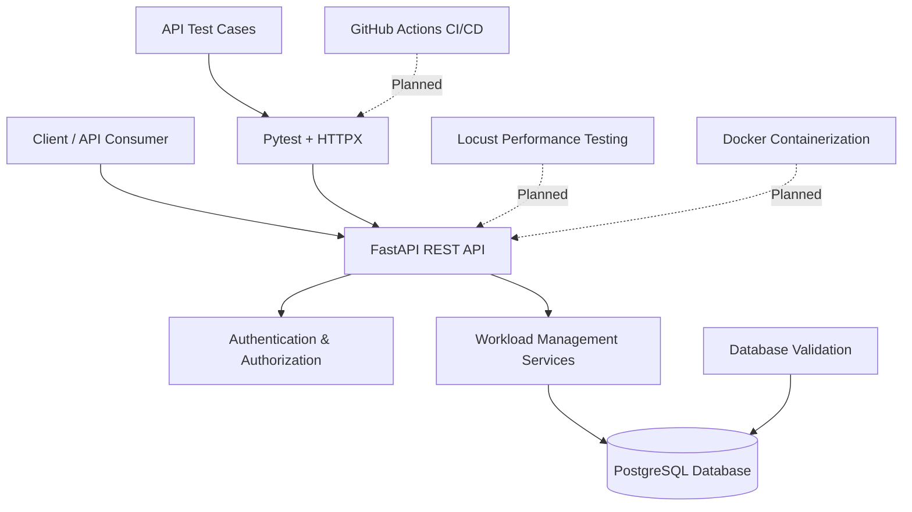

# Enterprise Backend & API Reliability Testing

**A Software Quality Engineering project focused on backend API testing, automation, database integrity, security, and reliability.**


---

## Project Overview

Modern backend applications must remain reliable, secure, and responsive under different operating conditions. This project focuses on validating a RESTful workload management API through systematic software quality assurance and backend testing.

The project involves developing automated tests to validate API functionality, authentication, request validation, database operations, and error handling. It is designed to progressively incorporate reliability testing, performance testing, and CI/CD practices.

### Objectives

- Automate REST API functional and integration testing.
- Validate API responses, HTTP status codes, and request handling.
- Verify database persistence and data integrity.
- Test authentication and authorization mechanisms.
- Identify defects through negative and boundary-value testing.
- Evaluate API reliability under concurrent requests.
- Measure performance under load and stress conditions.
- Integrate automated testing into a CI/CD workflow.

---

## System Architecture



---

## Technology Stack

| Category | Technologies |
|---|---|
| Programming Language | Python |
| Backend Framework | FastAPI |
| Database | PostgreSQL |
| ORM | SQLAlchemy |
| Database Migrations | Alembic |
| API Testing | HTTPX |
| Test Automation | Pytest |
| Authentication | JWT |
| Performance Testing | Locust — planned |
| Containerization | Docker — planned |
| CI/CD | GitHub Actions — planned |
| Version Control | Git & GitHub |

---

## Application Features

The backend is designed around a workload/job management system.

| Feature | Description |
|---|---|
| User Authentication | Token-based authentication |
| Job Submission | Submit workload requests through REST endpoints |
| Job Management | Retrieve and manage submitted jobs |
| Input Validation | Validate request payloads and resource parameters |
| Database Persistence | Store workload information in PostgreSQL |
| Error Handling | Return appropriate HTTP errors for invalid operations |
| Access Control | Restrict protected API operations to authenticated users |

---

## Quality Assurance & Testing

The project follows a structured testing approach.

### Automated API Testing

- Validate endpoint functionality.
- Verify HTTP response status codes.
- Validate response schemas and payloads.
- Test valid and invalid requests.
- Verify authentication requirements.
- Test missing, malformed, and invalid authorization tokens.

### Integration Testing

- Verify API-to-database interactions.
- Validate successful data persistence.
- Test database constraints.
- Check invalid resource values and boundary conditions.

### Reliability Testing — Planned

- Concurrent API requests.
- Concurrent job submissions.
- Database integrity under concurrent operations.
- Recovery and error-handling scenarios.

### Security Testing — Planned / In Progress

- Authentication and authorization checks.
- Resource ownership validation.
- Invalid input and boundary-value testing.
- Error message disclosure checks.
- Basic API security validation.

### Performance Testing — Planned

Using Locust to evaluate:

- Load testing
- Stress testing
- Spike testing
- Endurance testing

Performance measurements will include response times, throughput, requests per second, and failure rates.

---

## Project Structure

```text
enterprise-api-reliability/
│
├── app/
│   ├── main.py
│   ├── api/
│   ├── core/
│   ├── db/
│   ├── models/
│   ├── schemas/
│   └── services/
│
├── tests/
│   ├── unit/
│   ├── integration/
│   ├── api/
│   ├── reliability/
│   ├── security/
│   └── performance/
│
├── migrations/
├── reports/
├── docs/
│   └── screenshots/
│
├── docker/
├── .github/
│   └── workflows/
│
├── requirements.txt
├── pytest.ini
├── alembic.ini
├── .env.example
└── README.md
```

*Note: Directory structure may evolve as additional testing modules are implemented.*

---

## Getting Started

### 1. Clone the repository

```bash
git clone https://github.com/YOUR_USERNAME/enterprise-api-reliability.git
cd enterprise-api-reliability
```

### 2. Create a virtual environment

**Windows PowerShell**

```powershell
python -m venv .venv
.\.venv\Scripts\Activate.ps1
```

### 3. Install dependencies

```bash
pip install -r requirements.txt
```

### 4. Configure environment variables

Create a `.env` file in the root directory using `.env.example` as a template.

Configure the database connection string, JWT secret, and other required environment variables.

**Important:** Never commit `.env` files, passwords, or secret keys to GitHub.

### 5. Run database migrations

```bash
alembic upgrade head
```

### 6. Start the API server

```bash
uvicorn app.main:app --reload
```

### 7. Explore the API

Open the interactive API documentation:

- Swagger UI: http://127.0.0.1:8000/docs
- ReDoc: http://127.0.0.1:8000/redoc

---

## Running Automated Tests

Run the complete test suite:

```bash
pytest -v
```

Run specific test categories:

```bash
pytest tests/api -v
pytest tests/unit -v
pytest tests/integration -v
```

Run tests with code coverage:

```bash
pip install pytest-cov

pytest --cov=app --cov-report=term-missing
```

Generate an HTML coverage report:

```bash
pytest --cov=app --cov-report=html
```

The generated report will be available in the `htmlcov/` directory.

*Test commands should be adjusted to match the test folders currently implemented in the repository.*

---

## Development Roadmap

| Phase | Area | Status |
|---|---|---|
| 1 | Project Setup & Environment | Completed |
| 2 | Backend API Development | Completed / Core Implementation |
| 3 | Database Integration | Implemented |
| 4 | API Functional Testing | Implemented |
| 5 | Integration & Negative Testing | Implemented / In Progress |
| 6 | Advanced Reliability & Security Testing | Pending |
| 7 | Performance Testing with Locust | Pending |
| 8 | Docker & CI/CD Integration | Pending |
| 9 | Final QA Documentation & Reports | Pending |
| 10 | GitHub Presentation & Portfolio Finalization | In Progress |

---

## Future Enhancements

- Expand automated test coverage.
- Implement concurrency and database reliability tests.
- Integrate Locust performance testing.
- Containerize the backend using Docker.
- Implement automated testing pipelines using GitHub Actions.
- Generate automated test and coverage reports.
- Add structured logging and monitoring.
- Improve API documentation and test traceability.

---

## Author

**Jayaram S**

Software Quality Engineering | Python | API Testing | Test Automation

[GitHub Profile](https://github.com/1jayaram)

---

*This project is developed for learning and portfolio demonstration purposes. Performance and reliability conclusions will be based on actual test execution and recorded evidence.*